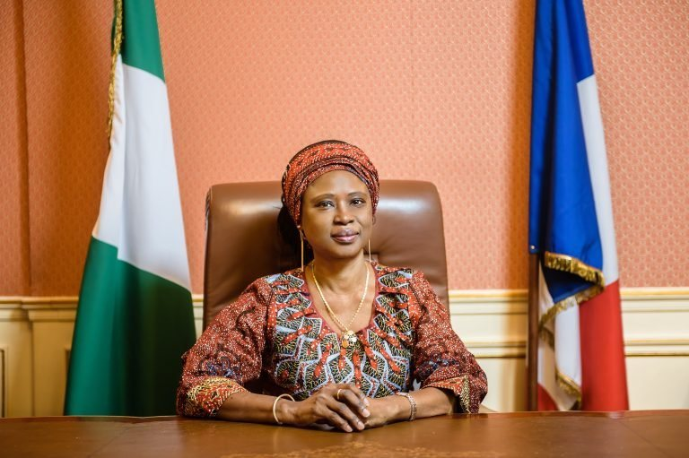

March 10, 2021

Your Excellency,  
Dr. Modupe Irele,  
The Ambassador of Nigeria to France,  
Paris, France.

**GOODWILL MESSAGE ON NEW APPOINTMENT**

On behalf of the entire management, board of directors and members of Friends of Nigeria (FON), we would like to offer our deep gratitude for your unwavering support, commitment and leadership. The France-Nigeria socio economic relations have become stronger and more robust during the course of your tenure as Ambassador of Nigeria to France.

We recall your very first landmark project of the Nigerian Creative Arts Exchange (NCAE) that was held from May 18 – 19, 2018, at Le Pavillon Dauphine, St. Clair, Paris. The event attracted various dignitaries such as Her Excellency, the wife of the Vice-President of Nigeria, Mrs Dolapo Osinbajo; Her Excellency, wife of the Governor of Edo State, Mrs Betsy Obaseki, renown business leaders from France and Nigeria, members of the nigerian diaspora in France , and leading creatives and artistic talents from Nigeria. This event reinforced Nigeria’s contribution in the field of Arts and Culture, and showcased Nigeria’s rich cultural heritage. Since then, there have been myriads of concrete events, projects and initiatives across various sectors that have been championed with the Embassy’s support.

The last two editions of Spotlight Nigeria Business and Investment Summit (2018 and 2019), 3rd and 4th editions respectively, experienced greater impact and we also have you to thank for your show of support and commitment. The Spotlight Nigeria, our flagship annual conference in Paris, provides a platform for collaboration and partnership between French Businesses and their Nigeerian counterpart. Your presence at these events, and the partnership with the Embassy under your leadership, sent a positive message to investors and businesses which attended from both countries.

We cannot but also make reference to the Nigeria-France Business Forum in 2020 in which the Embassy mobilized critical stakeholders from France on a successful trade mission to Nigeria. The reception offered by the Vice -President of Nigeria, Prof. Yemi Osibajo endorses the fact that the mission was well received and left its mark in the sands of time. Your partnership on all fronts on other projects such as the Salon de l’Agriculture as well as other salient initiatives to position Nigeria as an investment destination cannot be overemphasized. Your testimonials speak for themselves and little wonder the President of Nigeria and other Governors of various states visited France at different points within the last three years for productive bi-lateral engagements.

In strengthening collaboration between Nigeria and France in the areas of tech and entrepreneurship, you initiated in 2018 the Nigeria-France Tech Initiative (NFTI) which for the last two years has provided a free platform for support, leverage and incubation for Nigerian tech entrepreneurs, especially those founded by youths between the Ages of 18 and 35. The NFTI enjoys the collaboration of leading organizations and private sector companies between both countries including the French Development Agency (AFD) and the Nigeria Information Technology Development Agency(NITDA), to mention a few.

The ‘book of chronicles’ of the France-Nigeria relations is full of other engagements that were facilitated under your leadership and with your team at the Embassy. It is to this end that we want to place our words on the marble and express how proud we are to have enjoyed your collaboration. Our nation is indeed blessed to have such a visionary leader.

Finally, we would like to congratulate you for an exceptional service here in France and wish you a more rewarding time in your next assignment as the Ambassador of Nigeria to Hungary, Croatia and Serbia. We have no doubt that a greater legacy awaits you there.

Thank you once again Your Excellency and we look forward to greater collaborations as we continue to contribute our quota to Nigeria’s development in our role as a foremost diaspora organization in France whose members are leading professionals across all works of life.

Signed: Board Management – Friends of Nigeria (FON) Europe
