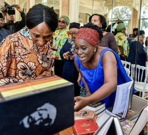
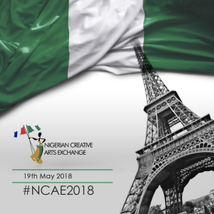

 

On Saturday 19th of May, 2018, at Le Pavillon Dauphine, St. Clair, Paris was treated to the depth and richness of the Nigerian culture as the Nigerian Creative Arts Exchange showcased the best of Nigeria’s fashion, arts, cuisine, music, poetry and dance.  
Hosted by the Nigerian Embassy, France, the exhibition aims to create a platform for promoting cultural exchange and diplomacy and enhance social and economic collaboration between Nigeria and the world. In addition, it will also contribute to developing channels for commerce between Nigeria and France.

Delivering a speech on behalf of FON titled “Harnessing the critical role of youth as the engine for growth and national development” was Abiodun ODUNUGA (Director of Partnerships – FON). The speech was delivered at the Business Forum organized by the Nigerian Creative Arts Exchange held on Friday, 18 th May, 2018.

To download the full speech, [click here.](https://friendsofnigeria.net/wp-content/uploads/2018/06/FON-SPEECH-AT-NCAE-2018-1.pdf)
