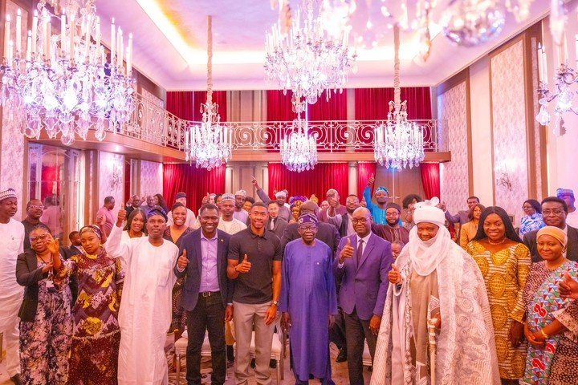
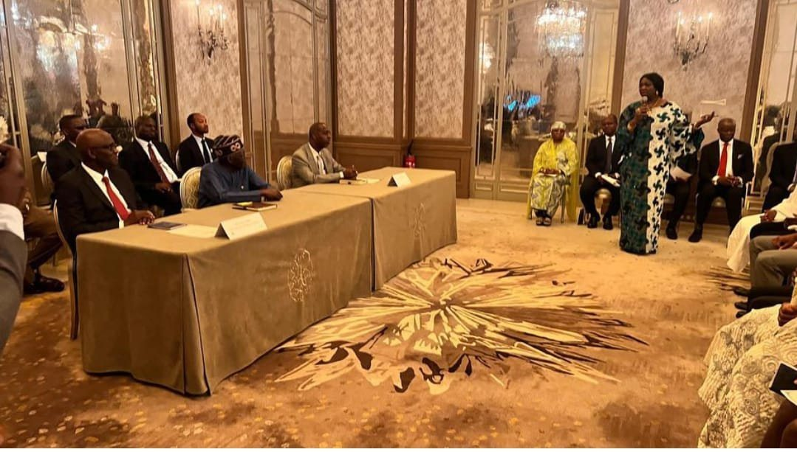
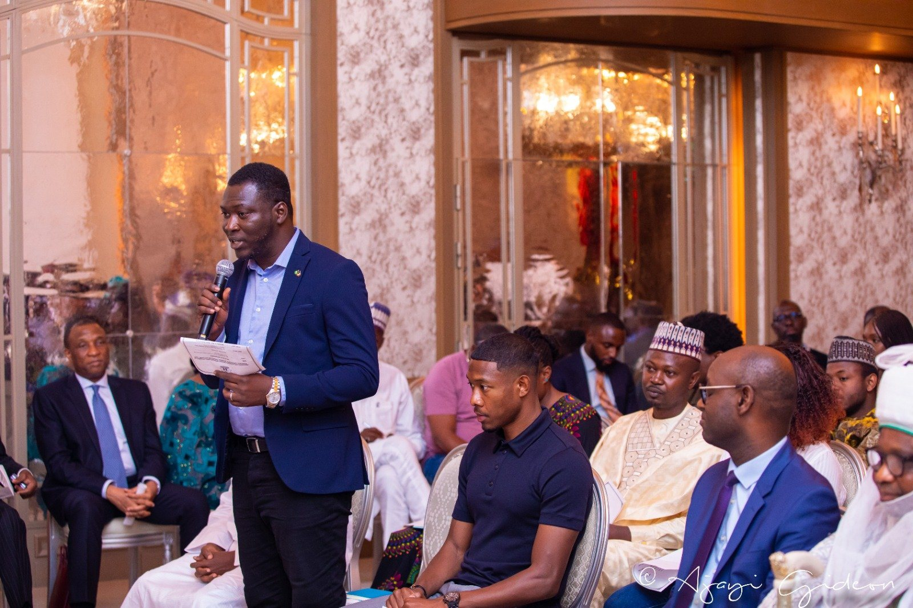
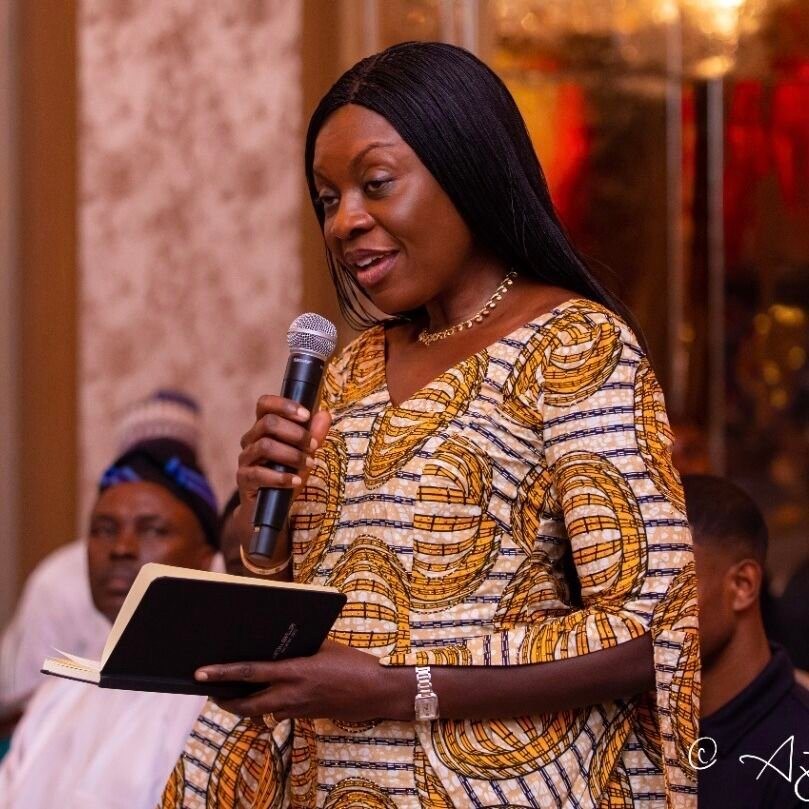

President Bola Tinubu embarked on his first official international trip as the President of Nigeria, visiting France for the Summit for a New Global Financing Pact hosted by President Emmanuel Macron. During this visit, President Tinubu had a significant meeting with the Nigerian Diaspora community in Paris on Friday, June 23rd, where he addressed various key reforms and engaged in an open discussion on crucial matters.

The event, moderated by Mr. Dele Alake, Special Adviser to President Tinubu on Special Duties, Communications, and Strategy, saw the presence of esteemed dignitaries, including H.E. Ambassador Kayode Laro, the Nigerian Ambassador to France, H.E. Ambassador I. LAMUWA, Permanent Secretary to the Ministry of Foreign Affairs – Nigeria, and Ambassador Hajo Sani, Permanent Delegation of Nigeria to UNESCO, among others.

Honorable Abike Dabiri-Erewa, Chairman – Nigerians in Diaspora Commission

In her opening remarks addressed to the President, Honorable Abike Dabiri-Erewa ( Chairman – Nigerians in Diaspora Commission) gave an overview of the impact Nigerians in Diaspora have been making both in Nigeria and outside the shores of the country across various sectors.

Representing Friends of Nigerians (FON) were Abiodun Odunuga, Co-Founder of FON, alongside Dr. Anino Emuwa and Dr. Emmanuel Igah, Honorary Board Members. They had the honor of addressing President Tinubu on crucial matters concerning the diaspora, international business community in France and the EU.

Abiodun Odunuga, Co-Founder – FON

Abiodun Odunuga highlighted FON’s accomplishments over the years, particularly in attracting foreign investors to Nigeria through initiatives such as B2B engagements, trade missions, and the annual Spotlight Nigeria Business and Investment Summit. He commended President Tinubu’s landmark achievements, including the overhaul of the nation’s exchange rate policy and the removal of petroleum subsidies, which have significantly boosted foreign investors’ confidence in the Nigerian market. Abiodun also acknowledged the exemplary role of Honorable Abike Dabiri-Erewa, Chair and CEO of NIDCOM, in supporting FON’s bilateral engagements particularly related to improving the attractiveness and perception of Nigeria to the Diaspora and to foreign investors. He expressed assurance of the diaspora’s support in fostering international partnerships and anticipation of the passing of the diaspora bill to provide the Nigerian diaspora the adequate voice they deserve.

Dr. Anino Emuwa, Founder of Africa Women CEOs Network and Honorary Board Member of FON

Dr. Anino Emuwa, Honorary Board Member of FON and Founder of Africa Women CEOs Network, emphasized the importance of gender-balanced leadership in achieving economic and societal development. She called for the inclusion of competent female leaders in President Tinubu’s cabinet to ensure comprehensive progress.

Dr. Emmanuel Igah, FON Honorary Board Member, applauded President Tinubu’s bold reforms, particularly the overhaul of the nation’s foreign exchange policy, which has already garnered positivity in the international community and restored investor confidence in Nigeria.

Other members of the Nigerian diaspora community addressed salient issues, including unity and cohesion in the country, security, Lake-Chad restoration, reformation of the upstream oil and gas sector, diaspora investment, and the role of sports and the creative sector in development.

In his response and remarks, President Tinubu discussed his engagement in climate finance and energy transition during the Summit. He emphasized the importance of patience from the developed world as Nigeria and other African countries strive to build a green world. He advocated for increased financing to facilitate the transition, while also urging stakeholders to consider the population’s short-term challenges.

Regarding governance, President Tinubu reassured the diaspora of his commitment to serving the collective prosperity of all Nigerians, irrespective of party or tribal affiliations. He pledged to nurture the country’s democracy and promote shared prosperity. President Tinubu referenced his recent policy reforms, such as the removal of fuel subsidies, the appointment of new security chiefs, and monetary reforms, as evidence of his determination to move beyond business as usual. He reiterated that these reforms aim to serve the collective interest of all Nigerians, rather than benefiting a select few. The President also expressed his dedication to achieving the Sustainable Development Goals (SDGs), promoting gender equality, empowering women, investing in education, revamping agriculture, exploring innovative approaches to livestock farming, and leveraging technology and local expertise to enhance security.

President Tinubu’s engaging dialogue with the Nigerian diaspora community underscored his commitment to work for the well-being of all Nigerians, both at home and abroad. He emphasized the importance of unity, stability, and economic justice, recognizing Nigeria’s diversity as an asset that, if harnessed effectively, will contribute to the nation’s prosperity. 

President Tinubu concluded by affirming, “Nigeria belongs to all of us, and our diversity is an asset if we know how to use it for our prosperity. We must promote unity, stability, and economic justice for every one of us.”

Signed:

FON Board
