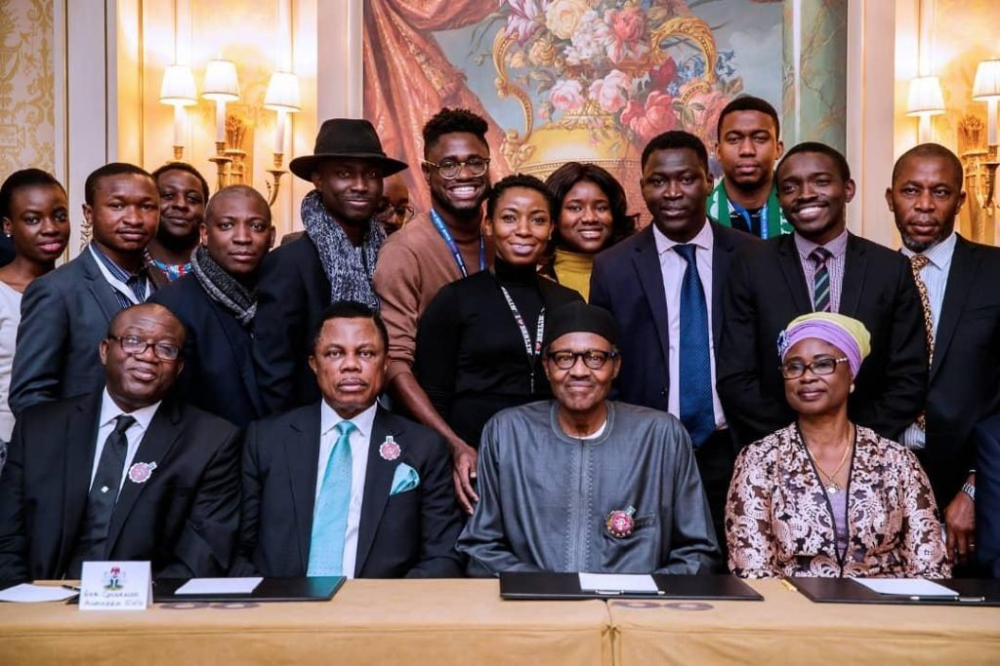

Yesterday, the 12th of November, 2018, Friends of Nigeria(FON) members participated at the interactive session with the President and the Nigerian community in France. This invitation was extended to our organization by the Ambassador of Nigeria to France and we consequently led a delegation of Nigerian professionals, some of whom were publicly honoured by the President for their sterling achievements in France.

FON participated at the event as an independent, non-political, non-religious organization and as a guest, we adhered to the order of events. Our values are driven by the passion for our nation, love for our people, respect for leadership and the sacred office of the President of our great nation, Nigeria. Our activities are driven by these values and as such, our flagship event, Spotlight Nigeria, which holds annually in Paris, brings together business leaders, entrepreneurs and investors from both countries. Concrete investments opportunities are discussed, deals are signed and economic growth is fostered for Nigeria and France.

Beyond the public engagements we had with the President bordering on issues such as Education, Diaspora engagement in electoral processes, security and infrastructural development, we are glad to also have begun internal conversation towards engaging the National Assembly on policy frameworks to engage the Diaspora more effectively.

We are grateful for the collaboration and immense support we received from Ambassador Modupe Irele and we will continue to nurture this relationship.

We remain committed to our mission of promoting increased socio-economic relations between Nigeria and France and to building the largest network of Nigerian professionals in France and across Europe. We shall continue to contribute our quota towards the economic development of our great country Nigeria and in the course of this, we would continue to work with relevant stakeholders and organizations involved, both in private circles as well as in government.

Signed: Friends of Nigeria (FON) Executive Board  
W: www.friendsofnigeria.net  
E: contact@friendsofnigeria.net
