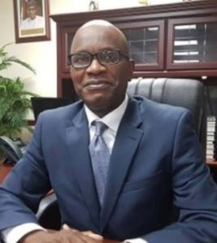
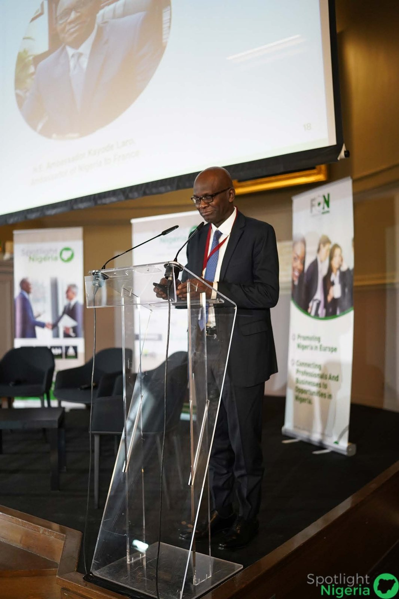

> We at Friends of Nigeria (FON) Europe and the entire diaspora community in France regret to announce the passing of our beloved Ambassador, His Excellency Kayode Laro, who passed on in the evening of Friday August 11, 2023. 

Tribute to Ambassador Kayode Laro – Friends of Nigeria (FON) Europe

Ambassador Laro was an astute diplomat, a leader par excellence and had an open door policy, which allowed for many transformational changes at the Embassy of Nigeria in Paris. Ambassador Laro in his stint at the Embassy made structural changes to the services and approach of service delivery at the Embassy.  In order to engage the diaspora and ease their bottlenecks, he traveled widely across France taking consular/passport services to cities beyond Paris. Some of the cities he traveled to with key embassy officials include Grenoble, Strasbourg, Le Havre, Nice, Marseille amongst others. At these meetings he provided a listening ear to suggestions and provided concrete feedback. 

In the area of bi-lateral engagements, Ambassador Laro led various engagements that strengthened the France-Nigeria bi-lateral relations along the lines of socio-economic developments. He supported innovative initiatives of different diaspora members, as well as Nigerians at home who needed the leverage to kick off their ventures in France.

The Governor of  Kwara State (his state of origin), Governor AbdulRahman AbdulRazaq expressed his sadness over the news. The press release by Rafiu Ajakaye (Chief Press Secretary to the Governor) on August 11, 2023 states: “*According to the Kwara State Governor AbdulRahman AbdulRazaq has described as shocking and devastating the death of Nigeria’s Ambassador to France Kayode Laro, praying to Allah to forgive him and grant him al-jannah Firdaus. The Governor said in a statement on Friday night that the death of the topflight career diplomat was one sad event too many, and urged the family to find comfort in his legacies as a statesman and his contributions to human capital development in Nigeria and Kwara State.”*

At Friends of Nigeria Europe, we cannot but credit a major part of the success of the 5th edition of Spotlight Nigeria Business Forum, which was held in Paris in October 2022 to the unwavering support of His Excellency, Ambassador Kayode Laro. Beyond Spotlighting Nigeria’s attractiveness to European investors through our engagements; we have equally enjoyed the support of the Embassy (under the excellent leadership of Amb. Laro) on other fronts which has contributed to reshaping the perspective of how the Nigeria diaspora is viewed before the international community. 

The most recent engagement we recall was his role in successfully hosting the President of Nigeria, President Bola Ahmed Tinubu (GCFR) during the President’s first official trip out of Nigeria as President and at the Summit for New Global Financing Pact in Paris in June 2023.

Our deepest condolences to our beloved Ambassador’s immediate family. We have no doubt that this is a big loss to the diaspora community, diplomatic mission and foreign service of our beloved country, Nigeria. We take solace in the fact that his legacy remains and his impact will live on in the mind of the international community forever.

Rest in peace dear, Ambassador Kayode Laro.

*Ambassador Laro at Spotlight Nigeria 2022*

**Signed: Board – Friends of Nigeria (FON) Europe**
